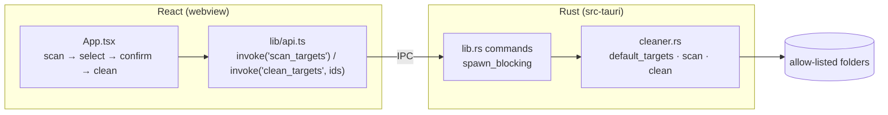

# 🧼 CleanCraft

[](https://github.com/eshginfarzali/cleancraft_desktop_app/actions/workflows/ci.yml)
[](https://github.com/eshginfarzali/cleancraft_desktop_app/actions/workflows/release.yml)
[](LICENSE)


A small cross-platform desktop app that finds **old cache and temp files** and deletes them after you confirm. The file-system work is in Rust and the UI is React. Release builds for macOS, Windows and Linux are produced by GitHub Actions.

> 🇦🇿 Azərbaycanca qısa təsvir [aşağıdadır](#-azərbaycanca).

<!-- Add screenshots to docs/screenshots and reference them here, e.g.:
<p align="center"></p>
-->

## Features

- **Scan:** for each allowed folder, shows how many files would be removed and how much space they take, plus how many folders could not be read.
- **Choose and confirm:** folders that have something to clean are pre-selected. Nothing is deleted until you confirm in a dialog that shows the total size.
- **Clean and report:** shows the space freed, the number of files deleted and how many could not be deleted (for example, files in use).
- **Non-blocking:** scans and cleans run on a background thread, so the window stays responsive.

## 🛡️ Safety: what gets deleted

CleanCraft works only on this fixed allow-list. The list is defined in Rust ([`src-tauri/src/cleaner.rs`](src-tauri/src/cleaner.rs)). The UI sends target **ids** (`temp`, `user-cache`), never file paths, so the front end cannot point the cleaner anywhere else.

| OS      | Folder                                                       | Target id    |
| ------- | ------------------------------------------------------------ | ------------ |
| macOS   | `$TMPDIR` (your per-user temp folder under `/var/folders/…`) | `temp`       |
| macOS   | `~/Library/Caches`                                           | `user-cache` |
| Linux   | `$TMPDIR` or `/tmp`                                          | `temp`       |
| Linux   | `$XDG_CACHE_HOME`, or `~/.cache` if it is not set            | `user-cache` |
| Windows | `%TEMP%`                                                     | `temp`       |

Inside those folders:

- Only **regular files** whose last modification is **more than 24 hours old** are deleted. Recent files are assumed to be in use.
- **Symlinks are never followed or deleted**, so a link cannot lead the cleaner outside the folder.
- **Folders are never removed**, only files, so apps keep their cache directory structure.
- Sockets, pipes and device files are ignored.
- Files that cannot be deleted (permissions, locks, other users' files in `/tmp`) are skipped and counted.

CleanCraft **never touches** Downloads, Documents, the Trash or Recycle Bin, browser profiles, system-wide folders such as `/Library/Caches`, `/var` or `C:\Windows\Temp`, or any path outside the table above. Deleted files are **not** moved to the Trash and cannot be recovered.

## Tech stack

| Layer    | Choice                                                                                   |
| -------- | ---------------------------------------------------------------------------------------- |
| Shell    | Tauri 2 (strict CSP, core permissions only)                                              |
| Backend  | Rust: `std::fs` walk with `symlink_metadata`, `serde` for IPC types                      |
| Frontend | React 19, TypeScript (`strict`), Vite                                                    |
| Tests    | `cargo test` with `tempfile` / `filetime`; Vitest + Testing Library with Tauri `mockIPC` |
| CI / CD  | GitHub Actions: lint, typecheck, tests, clippy; `tauri-action` release builds            |

## Architecture



## Install

Download the installer for your OS from [Releases](https://github.com/eshginfarzali/cleancraft_desktop_app/releases). Builds are **not code-signed**:

- **macOS:** the first time, right-click CleanCraft.app and choose **Open**.
- **Windows:** in SmartScreen, choose **More info → Run anyway**.

## Development

Prerequisites: Node.js 22, Rust (stable), and the [Tauri system dependencies](https://tauri.app/start/prerequisites/) for your OS.

```bash
npm install
npm run tauri dev       # app with hot reload
npm run tauri build     # installers in src-tauri/target/release/bundle
```

## Scripts and checks

| Command                                       | Description                        |
| --------------------------------------------- | ---------------------------------- |
| `npm run lint`                                | ESLint, zero warnings              |
| `npm run typecheck`                           | TypeScript for app and Vite config |
| `npm test`                                    | Vitest (formatting + UI flow)      |
| `npm run format:check`                        | Prettier                           |
| `cd src-tauri && cargo test`                  | Rust cleaner tests                 |
| `cd src-tauri && cargo clippy -- -D warnings` | Rust lints                         |

## Testing

- **Rust** (`cleaner.rs`): builds real temporary directories with backdated files. It checks that only files older than the threshold are counted and deleted, that fresh files and folders survive, that symlinks to files and folders outside the target are left alone, that missing folders are reported, and that the allow-list contains only absolute, existing paths.
- **Frontend:** byte formatting, plus the full UI flow against a mocked Tauri IPC: the scan pre-selects the right folders, cleaning needs confirmation, Cancel deletes nothing, only target ids are sent, and errors are shown.

## Releases

`.github/workflows/release.yml` runs [`tauri-action`](https://github.com/tauri-apps/tauri-action) when a `v*` tag is pushed. It builds on macOS (Apple Silicon and Intel), Windows and Linux and attaches the installers to a **draft** GitHub Release:

```bash
git tag v0.1.0 && git push origin v0.1.0
```

## Roadmap

- [ ] Move files to the system Trash instead of deleting them permanently
- [ ] Let the user change the 24-hour age threshold
- [ ] Per-app breakdown inside `~/Library/Caches` / `~/.cache`
- [ ] Code signing and notarization for macOS and Windows
- [ ] Auto-updates via the Tauri updater

## License

[MIT](LICENSE) © Eshgin Farzaliyev

---

## 🇦🇿 Azərbaycanca

**CleanCraft** müvəqqəti (temp) və cache qovluqlarında **24 saatdan köhnə** faylları tapır və sənin təsdiqindən sonra silir. Fayl əməliyyatları Rust-da, interfeys React-də yazılıb.

**Silinən qovluqlar:** macOS-da `$TMPDIR` və `~/Library/Caches`; Linux-da `/tmp` və `~/.cache`; Windows-da `%TEMP%`. Symlink-lərə keçid edilmir və qovluqların özü silinmir. Downloads, Documents, Zibil qutusu və sistem qovluqlarına heç vaxt toxunulmur. Silinən fayllar Zibil qutusuna getmir, birdəfəlik silinir.

İşə salmaq: `npm install`, sonra `npm run tauri dev`.
