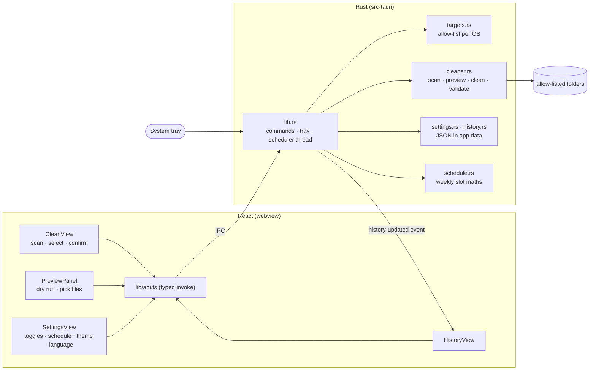

# 🧼 CleanCraft

[](https://github.com/eshginfarzali/cleancraft_desktop_app/actions/workflows/ci.yml)
[](https://github.com/eshginfarzali/cleancraft_desktop_app/actions/workflows/release.yml)
[](LICENSE)


A small cross-platform desktop app that finds **old cache and temp files** in a fixed set of folders, shows you exactly what it would delete, and deletes it after you confirm. It can also clean on a weekly schedule from the system tray. The file-system work is done in Rust and the UI in React. GitHub Actions builds releases for macOS, Windows and Linux.

> 🇦🇿 Azərbaycanca qısa təsvir [aşağıdadır](#-azərbaycanca).

<!-- Add screenshots to docs/screenshots and reference them here, e.g.:
<p align="center"></p>
-->

## Features

- **Scan:** for each folder that is turned on, shows how many files would be removed and how much space they take, plus the total you can free.
- **Dry-run preview:** lists the files a clean would delete (largest first, with size and last-modified date). You can tick individual files and delete only those. Large folders show the 2,000 largest entries, and the totals still cover everything.
- **Clean whole folders** after a confirmation that shows the total size.
- **Clean history:** every clean is logged locally — when, what triggered it (manual, selected files or schedule), how much was freed, and how many files failed. The history shows a running total.
- **More targets, each switched on or off separately:** Chrome, Edge and Firefox caches; npm, Yarn and pnpm caches; Xcode DerivedData; and on Windows, known cache folders inside `%LOCALAPPDATA%`. Only system temp and app caches are on by default.
- **System tray and weekly schedule:** closing the window keeps CleanCraft in the tray. The tray menu can open the app, clean now or quit. An optional weekly clean runs at the day and hour you choose.
- **Light, dark or system theme**, and **English or Azerbaijani** UI. The tray menu follows the chosen language.

## 🛡️ Safety: what gets deleted

Every folder CleanCraft may touch is defined in Rust, in [`src-tauri/src/targets.rs`](src-tauri/src/targets.rs). **There is no way to enter a path.** The UI refers to folders by id, and turning one on or off is the only choice you have.

### The allow-list

| Target id            | macOS                                        | Linux                                                | Windows (`%LOCALAPPDATA%` = `LAD`)                                   | Default |
| -------------------- | -------------------------------------------- | ---------------------------------------------------- | -------------------------------------------------------------------- | ------- |
| `temp`               | `$TMPDIR` (per-user, under `/var/folders`)   | `$TMPDIR` or `/tmp`                                  | `%TEMP%`                                                             | on      |
| `user-cache`         | `~/Library/Caches`                           | `$XDG_CACHE_HOME` or `~/.cache`                      | `LAD\Microsoft\Windows\INetCache`, `LAD\CrashDumps`, `LAD\D3DSCache` | on      |
| `chrome`             | `~/Library/Caches/Google/Chrome`             | `~/.cache/google-chrome`                             | `LAD\Google\Chrome\User Data\<profile>\Cache`                        | off     |
| `edge`               | `~/Library/Caches/Microsoft Edge`            | `~/.cache/microsoft-edge`                            | `LAD\Microsoft\Edge\User Data\<profile>\Cache`                       | off     |
| `firefox`            | `~/Library/Caches/Firefox/Profiles/*/cache2` | `~/.cache/mozilla/firefox/*/cache2`                  | `LAD\Mozilla\Firefox\Profiles\*\cache2`                              | off     |
| `npm`                | `~/.npm/_cacache`                            | `~/.npm/_cacache`                                    | `LAD\npm-cache\_cacache`                                             | off     |
| `yarn`               | `~/Library/Caches/Yarn`                      | `~/.cache/yarn`                                      | `LAD\Yarn\Cache`                                                     | off     |
| `pnpm`               | `~/Library/pnpm/store`                       | `$XDG_DATA_HOME` or `~/.local/share` + `/pnpm/store` | `LAD\pnpm\store`                                                     | off     |
| `xcode-derived-data` | `~/Library/Developer/Xcode/DerivedData`      | —                                                    | —                                                                    | off     |

Browser targets clean only the **cache** folders, never profiles, cookies, history or passwords. On Windows, `%LOCALAPPDATA%` as a whole also holds application data and settings, so only the well-known cache folders inside it are listed.

### Rules inside those folders

- Only **regular files last modified more than 24 hours ago** are deleted. Recent files are assumed to be in use.
- **Symlinks are never followed or deleted.**
- **Folders are kept.** Xcode DerivedData is the one exception: it is cleaned **per project folder**, and a project folder is removed only when _nothing_ inside it changed in the last 24 hours. A project you are building is never left half-deleted.
- **Nested targets are separated.** On macOS, Chrome's cache is inside `~/Library/Caches`. Each file belongs to exactly one target, so sizes are not counted twice, and turning Chrome off really keeps its cache.
- **Selected files are checked again in Rust** before deletion. A path from the preview is deleted only if all of these hold, otherwise it is skipped and counted as "rejected":
  - it is absolute and has no `..`;
  - it is inside a root of a target that is turned on;
  - it is not inside another target;
  - no folder between the root and the file is a symlink;
  - it is still a stale regular file (or a stale project folder for DerivedData).
- Files that cannot be deleted (permissions, locks, other users' files in `/tmp`) are skipped and counted.
- Cleans are serialised, so the schedule, the tray and the window never run two at once.

CleanCraft **never touches** Downloads, Documents, the Trash or Recycle Bin, browser profiles, or system-wide folders such as `/Library/Caches`, `/var` or `C:\Windows\Temp`. Deleted files are **not** moved to the Trash and cannot be recovered.

Package manager caches are safe to clear: npm, Yarn and pnpm download missing packages again on the next install. For pnpm, `pnpm store prune` is the tool's own way to do this. CleanCraft's 24-hour rule and per-file deletion are a coarser alternative.

## Where data is stored

Settings (`settings.json`) and history (`history.json`, last 200 cleans) live in the app data folder:

- **macOS:** `~/Library/Application Support/com.eshginfarzali.cleancraft`
- **Windows:** `%APPDATA%\com.eshginfarzali.cleancraft`
- **Linux:** `~/.local/share/com.eshginfarzali.cleancraft`

Both files are written atomically. A missing or corrupt file falls back to the defaults or an empty history.

## Tech stack

| Layer    | Choice                                                                                               |
| -------- | ---------------------------------------------------------------------------------------------------- |
| Shell    | Tauri 2 with the tray icon feature, strict CSP and core permissions only                             |
| Backend  | Rust: `std::fs` walk with `symlink_metadata`, `serde` for IPC and storage, `chrono` for the schedule |
| Frontend | React 19, TypeScript (`strict`), Vite; a small typed EN/AZ dictionary instead of an i18n library     |
| Tests    | `cargo test` with `tempfile` / `filetime`; Vitest + Testing Library with Tauri `mockIPC`             |
| CI / CD  | GitHub Actions: lint, typecheck, tests, clippy; `tauri-action` release builds                        |

## Architecture



| Command                          | Purpose                                                         |
| -------------------------------- | --------------------------------------------------------------- |
| `get_targets`                    | The allow-list for this OS, with availability and on/off state  |
| `scan_targets`                   | Totals for every target that is on                              |
| `preview_target`                 | Dry run for one target: entries a clean would delete            |
| `clean_targets`                  | Clean whole targets (by id)                                     |
| `clean_selected`                 | Delete picked preview entries (each path re-validated)          |
| `get_history` / `clear_history`  | Local clean log                                                 |
| `get_settings` / `save_settings` | Enabled targets, schedule, theme, language (normalised in Rust) |

## Design decisions

- **Allow-list in code instead of user-defined paths.** A cleaner that accepts arbitrary paths can be pointed at the wrong folder by mistake, or by a compromised webview. Ids keep the decision about _what is safe to delete_ in reviewed, tested Rust code.
- **Age threshold instead of "is the app running?".** Detecting which process owns a cache is OS-specific and unreliable. The 24-hour rule is simple, predictable and conservative.
- **Re-validating selected paths.** The preview could be stale, or the UI could send anything. Deletion re-checks every rule at the moment of deletion.
- **Per-project DerivedData.** Deleting single intermediate build files can confuse Xcode's incremental build. Removing a whole project folder that has been idle for a day just means a clean rebuild.
- **Scheduler thread instead of OS schedulers.** A weekly in-app check (once a minute, catching up after the computer was off) works the same on all three OSes without installing launchd, Task Scheduler or cron entries. The trade-off: it runs only while CleanCraft is running. Starting at login is on the roadmap.
- **Hand-written i18n.** Two languages and about 90 strings do not justify a library. A test makes sure both dictionaries have the same keys and placeholders.

## Install

Download the installer for your OS from [Releases](https://github.com/eshginfarzali/cleancraft_desktop_app/releases). Builds are **not code-signed**:

- **macOS:** the first time, right-click CleanCraft.app and choose **Open**.
- **Windows:** in SmartScreen, choose **More info → Run anyway**.

## Development

Prerequisites: Node.js 22, Rust (stable), and the [Tauri system dependencies](https://tauri.app/start/prerequisites/) for your OS.

```bash
npm install
npm run tauri dev       # app with hot reload
npm run tauri build     # installers in src-tauri/target/release/bundle
```

## Scripts and checks

| Command                                                     | Description                        |
| ----------------------------------------------------------- | ---------------------------------- |
| `npm run lint`                                              | ESLint, zero warnings              |
| `npm run typecheck`                                         | TypeScript for app and Vite config |
| `npm test`                                                  | Vitest                             |
| `npm run format:check`                                      | Prettier                           |
| `cd src-tauri && cargo test`                                | Rust tests                         |
| `cd src-tauri && cargo clippy --all-targets -- -D warnings` | Rust lints                         |

## Testing

- **Rust** (37 tests, on real temporary directories with backdated files):
  - `targets.rs`: the allow-list for every OS has unique ids, only absolute paths and opt-in extras. Browser profiles are discovered and symlinked profiles skipped. XDG dirs are honoured. Windows uses only known `%LOCALAPPDATA%` cache folders. Nested targets are excluded from the enclosing one.
  - `cleaner.rs`: the age rule; symlinks are never followed; preview ordering, totals and truncation; selected-path validation rejects paths outside the target, `..`, relative paths, symlinked parents, paths inside another target and fresh files; per-project DerivedData cleaning.
  - `settings.rs` / `history.rs`: round-trips, partial and corrupt files, normalisation, and the history cap.
  - `schedule.rs`: weekly slot maths, running once per slot, and catching up on a missed slot.
- **Frontend** (29 tests, against a mocked Tauri IPC):
  - the scan, the freeable total, and confirm before clean;
  - preview: select one, select all and none, and only the chosen paths are sent;
  - history: ordering, totals and clear;
  - settings: target toggles, unavailable targets and no path input anywhere;
  - schedule, theme (including following the OS), language switching, and a check that the EN and AZ dictionaries are identical in keys and placeholders.

## Releases

`.github/workflows/release.yml` runs [`tauri-action`](https://github.com/tauri-apps/tauri-action) when a `v*` tag is pushed. It builds on macOS (Apple Silicon and Intel), Windows and Linux and attaches the installers to a **draft** GitHub Release. See [CHANGELOG.md](CHANGELOG.md).

```bash
git tag v0.2.0 && git push origin v0.2.0
```

## Roadmap

- [ ] Move files to the system Trash instead of deleting them permanently
- [ ] Let the user change the 24-hour age threshold
- [ ] Start at login (Tauri autostart plugin) so the weekly schedule does not depend on the app being open
- [ ] Desktop notification after a scheduled clean
- [ ] Code signing and notarization for macOS and Windows
- [ ] Auto-updates via the Tauri updater

## License

[MIT](LICENSE) © Eshgin Farzaliyev

---

## 🇦🇿 Azərbaycanca

**CleanCraft** əvvəlcədən müəyyən edilmiş qovluqlarda **24 saatdan köhnə** cache və müvəqqəti faylları tapır, nəyi siləcəyini əvvəlcə göstərir və sənin təsdiqindən sonra silir.

- **Önizləmə:** silinəcək faylların siyahısını ölçü və tarixi ilə göstərir. Faylları tək-tək seçib yalnız onları silə bilərsən.
- **Tarixçə:** hər təmizləmə lokal olaraq yazılır və ümumi boşaldılmış yer göstərilir.
- **Əlavə hədəflər:** Chrome, Edge və Firefox cache-ləri, npm, Yarn və pnpm cache-ləri, Xcode DerivedData. Hər biri ayrıca aktiv və ya deaktiv edilir. Yol daxil etmək mümkün deyil.
- **Windows:** `%LOCALAPPDATA%` daxilindəki tanınmış cache qovluqları dəstəklənir.
- **System tray və həftəlik təmizləmə:** pəncərəni bağlayanda tətbiq tray-də qalır. Seçdiyin gün və saatda avtomatik təmizləyir.
- **Tema və dil:** işıqlı, qaranlıq və sistem teması; EN və AZ dilləri.

Symlink-lərə keçid edilmir. Downloads, Documents, Zibil qutusu və sistem qovluqlarına heç vaxt toxunulmur. Silinən fayllar Zibil qutusuna getmir, birdəfəlik silinir.

İşə salmaq: `npm install`, sonra `npm run tauri dev`.
